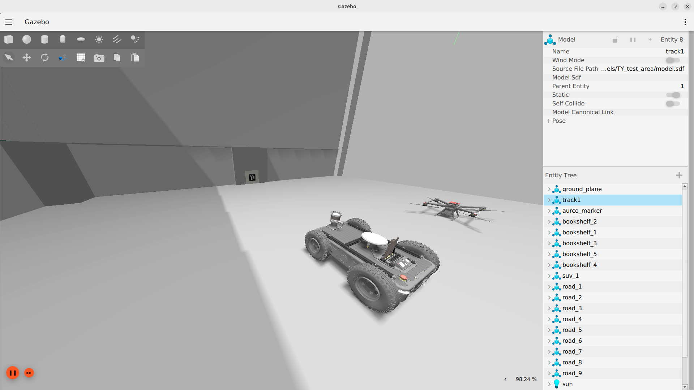

# Avular combined simulation

This repository contains a combined Gazebo simulation environment for the Avular Origin One and the Avular Vertex One. It uses **Gazebo Fortress and ROS 2 Humble**, and lets you spawn either robot on its own or both robots together in the same world.

The package itself only contains the worlds, models, simulation overlays (URDF xacros that layer Gazebo plugins on top of the kinematic descriptions), per-robot ROS/Gazebo bridge configs, and the launch files. The robot descriptions themselves come from the separate `origin_one_description` and `vertex_one_description` packages.

> **Note:** This is the `humble` branch (ROS 2 Humble + Gazebo Fortress). For ROS 2 Jazzy + Gazebo Harmonic, see the [`jazzy`](https://github.com/avular-robotics/avular_simulations/tree/jazzy) branch.

## Getting started

You have two options for running the simulation:

- **Option A — Native install** on Ubuntu 22.04 with ROS 2 Humble installed locally.
- **Option B — Docker** on any Linux distribution (or other Ubuntu releases where Humble isn't natively supported).

If you're on Ubuntu 22.04 and plan to develop against this code, native is faster and lighter. If you're on a different OS version or just want to try the simulation without committing to a Humble install, use Docker.

---

### Option A — Native install (Ubuntu 22.04 + ROS 2 Humble)

For installing ROS 2 Humble on your system, refer to the [ROS 2 Humble installation guide](https://docs.ros.org/en/humble/Installation.html). After making sure that ROS 2 Humble is installed, install Gazebo Fortress and supporting tools:

```bash
sudo apt update
sudo apt install ros-humble-ros-gz ros-humble-ros-gz-sim ros-humble-ros-gz-bridge \
python3-rosdep git-lfs
```

Make a ROS workspace on your computer (for instructions, see the [ROS tutorial](https://docs.ros.org/en/humble/Tutorials/Beginner-Client-Libraries/Creating-A-Workspace/Creating-A-Workspace.html)). Then go to the `src` folder of your workspace and clone the three repositories:

```bash
cd <your-ros-workspace>/src

git clone -b humble git@github.com:avular-robotics/avular_robot_simulation.git
git clone -b main git@github.com:avular-robotics/avular_origin_description.git
git clone -b main git@github.com:avular-robotics/avular_uav_descriptions.git

cd avular_origin_description && git lfs pull && cd ..
cd avular_uav_descriptions && git lfs pull && cd ..
```

Install the remaining ROS dependencies via rosdep, then build:

```bash
cd <your-ros-workspace>
rosdep install --from-paths src --ignore-src -r -y
source /opt/ros/humble/setup.bash
colcon build --symlink-install
```

Source the workspace:

```bash
source install/setup.bash
```

To source the workspace automatically in every shell, append it to your `~/.bashrc`:

```bash
echo "source <path_to_workspace>/install/setup.bash" >> ~/.bashrc
```

You're done. Skip to [Launching the simulation](#launching-the-simulation).

---

### Option B — Docker

The Docker setup lets you run the simulation on any Linux distribution, including Ubuntu versions where ROS 2 Humble isn't available natively.

**Prerequisites:**
- Docker Engine (native install — Docker Desktop is *not* recommended for GPU passthrough)
- NVIDIA Container Toolkit (if you have an NVIDIA GPU)
- An X11 display server

Install Docker and the NVIDIA Container Toolkit if you haven't already:

```bash
# Docker — follow https://docs.docker.com/engine/install/ubuntu/

# NVIDIA Container Toolkit (NVIDIA GPU users only)
curl -fsSL https://nvidia.github.io/libnvidia-container/gpgkey \
  | sudo gpg --dearmor -o /usr/share/keyrings/nvidia-container-toolkit-keyring.gpg
curl -s -L https://nvidia.github.io/libnvidia-container/stable/deb/nvidia-container-toolkit.list \
  | sed 's#deb https://#deb [signed-by=/usr/share/keyrings/nvidia-container-toolkit-keyring.gpg] https://#g' \
  | sudo tee /etc/apt/sources.list.d/nvidia-container-toolkit.list
sudo apt update && sudo apt install -y nvidia-container-toolkit
sudo nvidia-ctk runtime configure --runtime=docker
sudo systemctl restart docker
```

Set up your workspace and clone the three repositories:

```bash
mkdir -p ~/avular_ws/src && cd ~/avular_ws/src

git clone -b humble git@github.com:avular-robotics/avular_robot_simulation.git
git clone -b main git@github.com:avular-robotics/avular_origin_description.git
git clone -b main git@github.com:avular-robotics/avular_uav_descriptions.git

cd avular_origin_description && git lfs pull && cd ..
cd avular_uav_descriptions && git lfs pull && cd ..
```

Allow Docker containers to connect to your X server, then start the container:

```bash
xhost +local:docker
cd ~/avular_ws/src/avular_robot_simulation
docker compose -f docker/docker-compose.yml up -d --build
```

Drop into a shell and build the workspace:

```bash
docker exec -it avular-sim-humble bash
# inside the container:
cd /root/ros2_ws
rosdep install --from-paths src --ignore-src -r -y
colcon build --symlink-install
source install/setup.bash
```

You're now ready to launch the simulation. Continue to [Launching the simulation](#launching-the-simulation).

The source code is mounted from your host into the container, so edits you make on the host are immediately reflected inside the container. After editing, re-run `colcon build --symlink-install` inside the container.

To stop and remove the container later:

```bash
docker compose -f docker/docker-compose.yml down
```

---

## Launching the simulation

The commands below are identical whether you're running natively or inside the Docker container. Just make sure you've sourced the workspace first (`source install/setup.bash`).

### Both robots together

The combined bringup spawns the Origin One and the Vertex One in the same world, each under its own namespace (`/origin` and `/vertex`) and with its own TF prefix:

```bash
ros2 launch avular_simulations combined_sim_common.launch.py
```

The starting pose of each robot can be overridden with launch arguments:

```bash
ros2 launch avular_simulations combined_sim_common.launch.py \
  origin_pose_x:=0.0 origin_pose_y:=0.0 origin_pose_yaw:=0.0 \
  vertex_pose_x:=2.0 vertex_pose_y:=0.0 vertex_pose_z:=1.5 vertex_pose_yaw:=0.0
```

Other useful arguments:

- `world` — name of the world file to load (default `avular_testing_area.world`).
- `headless` — set to `true` to run Gazebo without the GUI client.
- `rviz` — set to `true` to additionally launch RViz pre-configured for the prefixed Origin and Vertex spawn.

### Single robot

You can also bring up either robot on its own:

```bash
ros2 launch avular_simulations origin_sim_common.launch.py
```

For the Origin you can additionally select the drive configuration (`skid_steer_drive` or `mecanum_drive`):

```bash
ros2 launch avular_simulations origin_sim_common.launch.py drive_configuration:=mecanum_drive
```

For the Vertex:

```bash
ros2 launch avular_simulations vertex_sim_common.launch.py
```

A convenience wrapper that loads the test world with sensible default poses for the Origin is also provided:

```bash
ros2 launch avular_simulations avular_testing_area.launch.py
```

This will show the avular simulation environment in Gazebo Fortress with the requested robot(s) spawned. You can drag the mouse to change the view to the robot model.



---

## Sensor and topic inventory

The tables below list every ROS topic the bridge exposes for each robot, the Gazebo topic it is bridged from, the message type, and the update rate where it is set in the URDF. All topic names use `<ns>` for the robot namespace:

- Single-robot launches (`origin_sim_common.launch.py`, `vertex_sim_common.launch.py`): `<ns>` defaults to `robot`.
- Combined launch (`combined_sim_common.launch.py`): `<ns>` is `origin` for the Origin and `vertex` for the Vertex.

Source: [`config/vertex/gazebo_ros_bridge.yaml`](config/vertex/gazebo_ros_bridge.yaml), [`config/origin/gazebo_ros_bridge.yaml`](config/origin/gazebo_ros_bridge.yaml).

### Vertex One

Sensors (all `GZ_TO_ROS`):

| ROS topic | Message type | Rate | Frame | Gz topic |
|---|---|---|---|---|
| `/<ns>/sensor/imu/data` | `sensor_msgs/Imu` | 100 Hz | `<tf_prefix>imu_link` | `/<ns>/imu` |
| `/<ns>/sensor/magnetometer/data` | `sensor_msgs/MagneticField` | 100 Hz | `<tf_prefix>imu_link` | `/<ns>/magnetometer` |
| `/<ns>/sensor/gnss/data` | `sensor_msgs/NavSatFix` | 10 Hz | `<tf_prefix>gnss_link` | `/<ns>/gnss` |

Commands, state, and system topics:

| ROS topic | Message type | Rate | Direction | Notes |
|---|---|---|---|---|
| `/<ns>/cmd_vel` | `geometry_msgs/Twist` | on-demand | ROS → Gz | Consumed by `MulticopterVelocityControl`. The Vertex must be enabled on the Gz-side `enable` topic before it responds (see *Driving and visualizing the robots* below). |
| `/<ns>/odom` | `nav_msgs/Odometry` | 30 Hz | Gz → ROS | Ground-truth odometry from `OdometryPublisher`. |
| `/<ns>/odom_with_covariance` | `nav_msgs/Odometry` | 30 Hz | Gz → ROS | Same data with covariance populated. |
| `/<ns>/joint_states` | `sensor_msgs/JointState` | sim step | Gz → ROS | Rotor joint states; required for RSP to resolve rotor TFs. |
| `/tf` | `tf2_msgs/TFMessage` | 30 Hz | Gz → ROS | Bridged from `/<ns>/tf`. |
| `/clock` | `rosgraph_msgs/Clock` | sim step | Gz → ROS | Sim time. |

### Origin One

Sensors (all `GZ_TO_ROS`):

| ROS topic | Message type | Gz topic |
|---|---|---|
| `/<ns>/camera/color/image_raw` | `sensor_msgs/Image` | `/<ns>/camera/image` |
| `/<ns>/camera/color/camera_info` | `sensor_msgs/CameraInfo` | `/<ns>/camera/camera_info` |
| `/<ns>/camera/depth/image_raw` | `sensor_msgs/Image` | `/<ns>/camera/depth_image` |
| `/<ns>/camera/depth/points` | `sensor_msgs/PointCloud2` | `/<ns>/camera/points` |
| `/<ns>/lidar/points` | `sensor_msgs/PointCloud2` | `/<ns>/lidar/points` |
| `/<ns>/gnss/fix_off` | `sensor_msgs/NavSatFix` | `/<ns>/gnss` |

Commands, state, and system topics:

| ROS topic | Message type | Direction | Notes |
|---|---|---|---|
| `/<ns>/cmd_vel` | `geometry_msgs/Twist` | ROS → Gz | Consumed by the DiffDrive or MecanumDrive plugin, depending on `drive_configuration`. |
| `/<ns>/odom` | `nav_msgs/Odometry` | Gz → ROS | Ground-truth odometry. |
| `/<ns>/joint_states` | `sensor_msgs/JointState` | Gz → ROS | Wheel joint states. |
| `/tf` | `tf2_msgs/TFMessage` | Gz → ROS | Bridged from `/<ns>/tf`. |
| `/clock` | `rosgraph_msgs/Clock` | Gz → ROS | Sim time. |

To inspect what is actually live for a running session, use `ros2 topic list` and `ros2 topic hz /<ns>/sensor/imu/data`.

---

## Driving and visualizing the robots

The simulation contains Gazebo plugins for the drive controllers (DiffDrive/MecanumDrive on the Origin, MulticopterVelocityControl on the Vertex), the Ouster LiDAR and the realsense camera on the Origin, and the IMU/magnetometer/GNSS sensors on both robots. Each robot publishes its sensor and odometry topics under its own namespace.

To visualize a robot and its sensors, use the RViz launch file shipped with the matching description package, passing the namespace and TF prefix used by the combined bringup:

```bash
ros2 launch origin_one_description origin_one_rviz.launch.py ns:=origin tf_prefix:=origin
ros2 launch vertex_one_description vertex_one_rviz.launch.py ns:=vertex tf_prefix:=vertex
```

When running a single robot under the default namespace, omit the `ns` and `tf_prefix` arguments.

You can drive the Origin/Vertex around in the simulation by publishing Twist messages to its `cmd_vel` topic. For example by using the `teleop_twist_keyboard` package:

```bash
sudo apt install ros-humble-teleop-twist-keyboard
```

For the Origin:

```bash
ros2 run teleop_twist_keyboard teleop_twist_keyboard --ros-args -r /cmd_vel:=/origin/cmd_vel
```

For the Vertex:

```bash
ros2 run teleop_twist_keyboard teleop_twist_keyboard --ros-args -r /cmd_vel:=/vertex/cmd_vel
```
